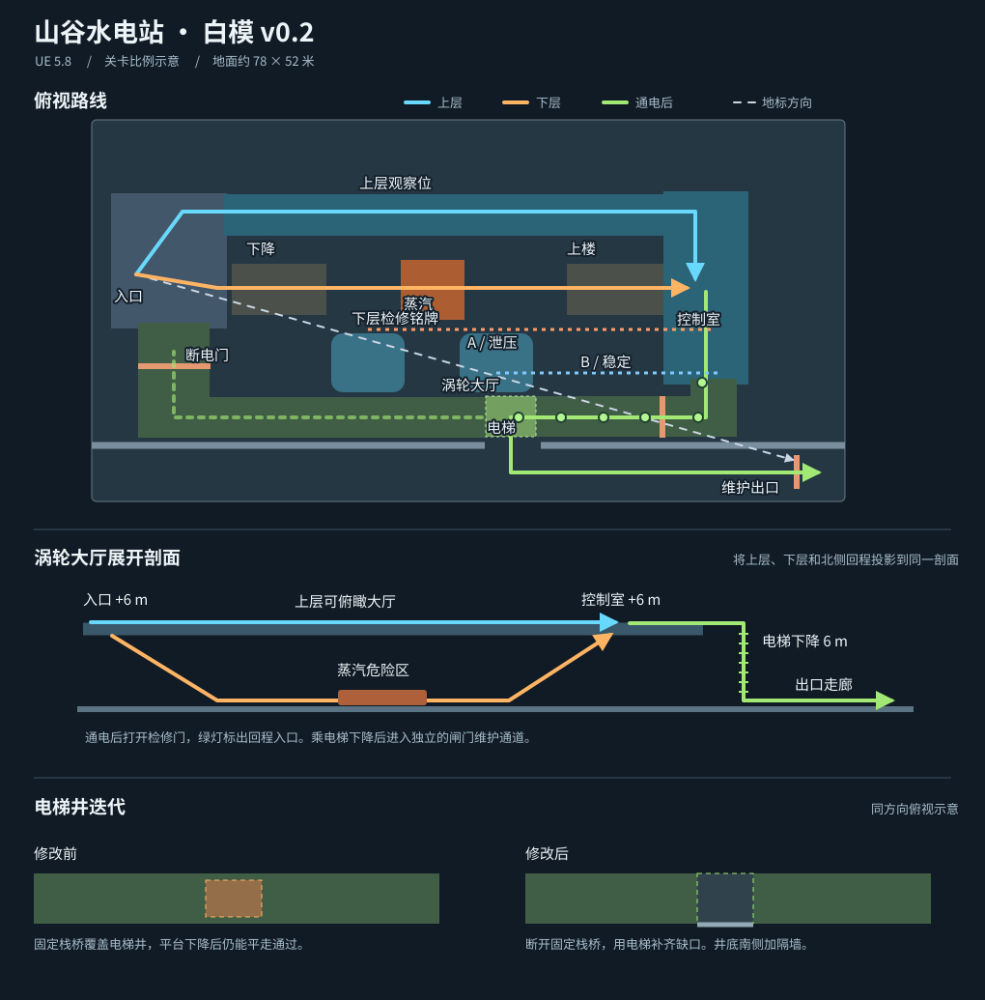

# 《山谷解密》关卡白模

UE 5.8 单人探索解谜原型，当前版本 v0.2。

打开 `解密地图：山谷关卡白模.uproject`，在编辑器中点击 Play 试玩。机关通过 PythonScriptPlugin 在编辑器单人 PIE 中运行。

[关卡设计与测试记录](ValleyHydro_README.md) · [路线与剖面图](ValleyHydro_Diagrams.svg)

工程制作使用了 AI 辅助。测试记录中的时间来自已知路线的脚本验证，首玩体验仍待真人盲测。

## 下载试玩

下载 [完整工程压缩包](ValleyHydro-v0.2.zip)，解压后用 UE 5.8 打开其中的 .uproject 文件。

